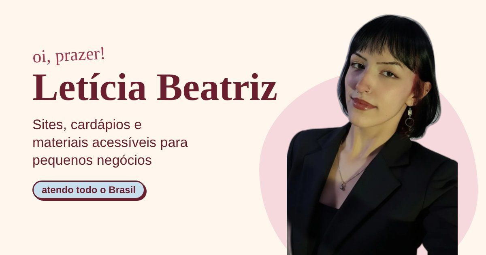
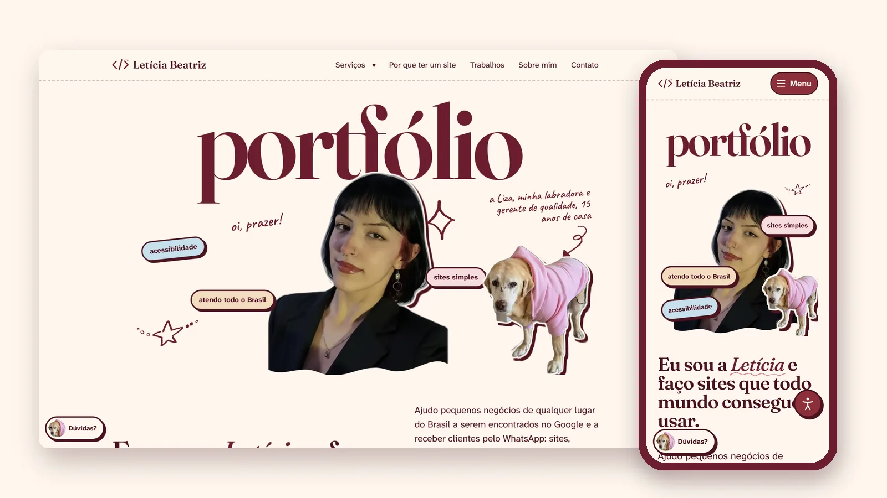
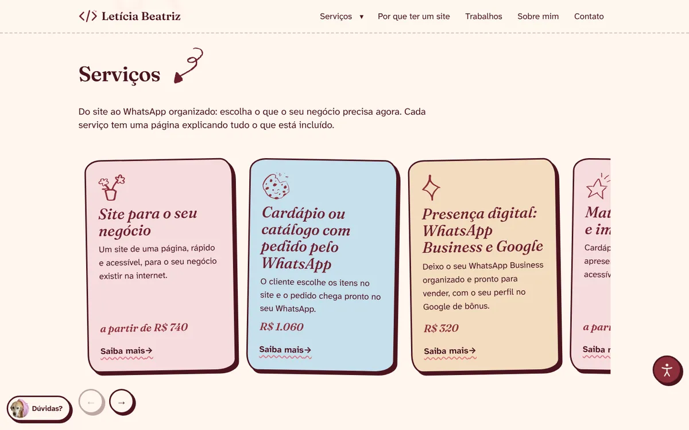

<div align="center">



# Letícia Beatriz · portfólio

**Site da minha marca: sites, cardápios com pedido pelo WhatsApp, materiais e planilhas simples e acessíveis para pequenos negócios de todo o Brasil**

[**Ver o site**](https://portfolio-85x.pages.dev/) &nbsp;·&nbsp; [Declaração de acessibilidade](https://portfolio-85x.pages.dev/#acessibilidade-declaracao) &nbsp;·&nbsp; [Privacidade](https://portfolio-85x.pages.dev/#privacidade)


</div>

> [!NOTE]
> **Endereço provisório.** O site ainda não foi divulgado. O domínio próprio (.com.br) entra perto do lançamento.

<br>

<p align="center">
  
</p>

## Sobre o projeto

| | |
|---|---|
| **Cliente** | Letícia Beatriz (marca própria) |
| **Tipo** | Site de página única, com uma tela para cada serviço |
| **Público** | Donos de pequenos negócios de todo o Brasil que querem ser encontrados no Google e receber clientes pelo WhatsApp |
| **Versão** | novembro de 2026 |
| **Feito por** | [Letícia Beatriz](https://github.com/let1ci4b) |

## Destaques

- **Colagem feita à mão.** Fotos recortadas, rabiscos desenhados por mim e anotações em letra cursiva. A Liza, minha labradora, aparece pela página toda.
- **Uma tela para cada serviço.** Cada um dos 6 serviços tem a sua página, com o que inclui, o preço, o que o cliente envia e como funciona. As telas abrem por âncora (`#servico-...`), e o botão "voltar" do celular funciona.
- **Pedir proposta sem sair do site.** O formulário do Tally fica embutido numa tela própria (`#pedir-proposta`), só carrega quando a pessoa abre essa tela e traz um aviso curto com link para a Política de privacidade.
- **Galeria de trabalhos.** Cada trabalho aparece como a tela do site, com os PDFs entregues atrás. Passar o mouse toca a abertura do site (no celular, toca uma vez quando aparece). Clicar abre a tela do projeto com tudo o que foi entregue: site, manuais, cardápio, planilhas e kit, cada um com o PDF.
- **Perguntas frequentes com a Liza.** Respostas prontas sobre cerca de 50 assuntos, sem inteligência artificial e sem coletar dados.
- **Menu de acessibilidade.** Texto de 90% a 160%, alto contraste, fonte mais legível, mais espaço entre linhas, destaque de links e parar animações. As escolhas ficam salvas no navegador e são aplicadas antes de a página aparecer. Com texto grande, a galeria vira uma coluna só.
- **Declaração de acessibilidade e Política de privacidade.** Duas telas próprias, com link no rodapé: o que o site cumpre e como foi testado, e quais dados o formulário recebe, para quê, por quanto tempo e como pedir para apagar (LGPD).
- **Card de compartilhamento e ícones.** O link aparece com foto, título e descrição no WhatsApp e nas redes. O logo "</>" aparece na aba do navegador, na tela inicial do iPhone e do Android.

<table>
  <tr>
    <td width="50%"></td>
    <td width="50%"></td>
  </tr>
  <tr>
    <td align="center"><sub>Serviços</sub></td>
    <td align="center"><sub>Trabalhos</sub></td>
  </tr>
</table>

## Qualidade

Testes feitos em 23/11/2026, no computador, com a página servida localmente.

| Teste | Resultado |
|---|---|
| **axe-core** (WCAG 2.2 AA) | Nenhuma violação em 360, 375 e 1440 px, na página inicial (com texto a 100% e a 160%), na Declaração de acessibilidade, na Política de privacidade e em "Pedir proposta" |
| **html-validate** (regras recomendadas) | Nenhum erro |
| **Validador W3C** (vnu) | Nenhum erro |
| **Lighthouse no celular** | Acessibilidade 100 · Boas práticas 100 · SEO 100 · Desempenho 69 (medido sem a compressão do Cloudflare; o número que vale é o do [PageSpeed](https://pagespeed.web.dev/) no endereço publicado) |
| **Peso da primeira carga** | Cerca de 885 KB |
| **Texto ampliado** | Com o menu em 160%, nada fica cortado e a página não rola para o lado em 320, 375 e 1280 px |
| **Teclado** | Percurso completo com a tecla Tab: todos os controles mostram o foco. Nomes acessíveis conferidos pelo axe; as prévias em vídeo ficam fora do Tab (cada trabalho é um link só) |
| **Movimento reduzido** | Com "reduzir movimento" no aparelho ou "Parar animações" no menu, a Liza não passeia e as aberturas dos trabalhos não tocam |

## Tecnologias

| | |
|---|---|
| **Base** | HTML, CSS e JavaScript escritos à mão, sem framework e sem etapa de montagem: o que está no repositório é o que vai para o ar |
| **Animações** | CSS e JavaScript próprios (prévias dos trabalhos, Liza que passeia, rabiscos que se desenham) |
| **Conteúdo** | Tudo no `index.html`. Fontes do Google Fonts: Fraunces (títulos), Atkinson Hyperlegible Next (texto) e Caveat (anotações) |
| **Formulário** | [Tally](https://tally.so), embutido na tela "Pedir proposta" |
| **Hospedagem** | [Cloudflare Pages](https://pages.cloudflare.com), publicado a cada envio para a branch `main` |
| **Métricas** | Cloudflare Web Analytics, que não usa cookies (ligar no painel do Cloudflare, se ainda não estiver ligado) |

## Rodar no computador

1. Instale o [Node.js 22](https://nodejs.org).
2. Abra o terminal na pasta do projeto.
3. Rode:
   ```bash
   npx http-server -c-1
   ```
4. Abra http://localhost:8080.

Não precisa instalar nada além disso: o site não tem dependências.

## O que muda e onde

| O quê | Arquivo |
|---|---|
| Textos, preços e serviços | `index.html` (cada serviço é um `<article class="servico-pagina">`) |
| Declaração de acessibilidade | `index.html`, tela `#acessibilidade-declaracao` (atualize a data do teste a cada mudança) |
| Política de privacidade | `index.html`, tela `#privacidade` (atualize a data se mudar algo) e o aviso `.pp-aviso` junto ao formulário |
| Menu de acessibilidade | `index.html`: lista `zooms` no script do menu e o script curto no `<head>` que aplica as escolhas salvas |
| Trabalhos da galeria | `index.html`, seção `#trabalhos`: copie um `<article class="proj">` (vídeo em `data-video`, prévia `img/abertura-<nome>.webp` e `.mp4`, 960 × 600) e crie a tela do projeto copiando um `<article id="trabalho-...">`. PDFs em `docs/` |
| Perguntas da Liza | `index.html`, lista de perguntas no script das dúvidas (palavras-chave e resposta) |
| WhatsApp e e-mail | `index.html` (procure `wa.me/` e `mailto:`) e a ficha do Google (`application/ld+json`) |
| Desenhos | `img/rabiscos.svg` (cada desenho é um símbolo `r-<nome>`) |
| Card de compartilhamento | `img/compartilhar.jpg` (1200 × 630) e as tags `og:` e `twitter:` no `<head>` do `index.html` |
| Ícones | `favicon.svg`, `favicon.ico`, `apple-touch-icon.png`, `icon-192.png`, `icon-512.png`, `icon-maskable-512.png` e `site.webmanifest` (gerados a partir do logo "</>") |
| Endereço do site | `index.html` (`canonical`, `og:url`, `og:image` e `application/ld+json`), `sitemap.xml` e `robots.txt` |
| Cache das imagens | `_headers` |

## Estrutura

```
index.html     a página inteira: HTML, CSS e JavaScript
404.html       página de "não encontrado", com a Liza
img/           fotos, recortes, desenhos (rabiscos.svg), fotos dos trabalhos e card de compartilhamento
docs/          imagens deste README (vitrine e prints)
favicon.svg    ícone da aba (e favicon.ico para navegadores antigos)
apple-touch-icon.png, icon-*.png   ícones da tela inicial (iPhone e Android)
site.webmanifest   nome, cores e ícones do site
_headers       cache das imagens no Cloudflare
robots.txt     regras para os buscadores
sitemap.xml    lista de páginas para o Google
```

## Publicar

**Cloudflare Pages (oficial):** cada envio para a branch `main` publica o site em https://portfolio-85x.pages.dev/ em cerca de 1 minuto.

Para refazer o projeto no Cloudflare:

1. **Workers & Pages** → Create → Pages → **Connect to Git** e escolha o repositório `portfolio`.
2. Framework preset: **None**. Build command: vazio. Build output directory: `/`.
3. **Save and Deploy**.
4. Para contar visitas sem cookies: no projeto, **Metrics** → **Enable** em Web Analytics.

## Créditos

- **Design, código e conteúdo:** Letícia Beatriz.
- **Fotos e desenhos:** meus. Não podem ser reutilizados sem autorização.
- **Fontes:** Fraunces, Atkinson Hyperlegible Next e Caveat, pelo Google Fonts, sob a licença SIL Open Font License.
- **Formulário:** Tally.

<br>

<p align="center"><sub>Feito à mão por Letícia Beatriz, com supervisão da Liza.</sub></p>
